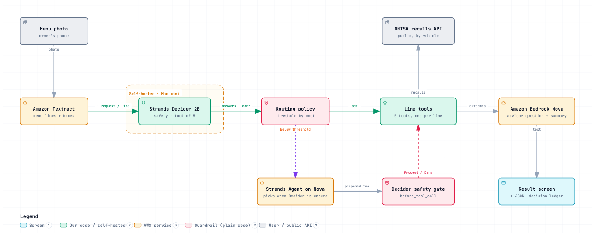

# decider-agent

> Entry **N2 Menu Line Check** for the AWS Builder Center "Agent Experience Hackathon: Strands Decider"
> (deadline 23.10.2026 23:59 PT). Sections still marked **TBD** are filled in before submission.
> `decider_kit` is the concept-agnostic toolkit, `menu_line_check` is the agent, and
> `patterns/menu_line_tool_selection/` is the reusable decision pattern.

## What it does

A car owner stands at a dealer's service counter with a printed service menu and takes one photo. The agent
splits the menu into lines and, for each line, Strands Decider 2B decides which tool fits: decline an optional
add-on, check the maintenance schedule against the odometer, look up recalls for this car (public NHTSA API),
ask about a fee, or leave a safety part (brakes, tires, alignment, steering) to the owner. How sure Decider must
be depends on what a wrong action costs: a decline needs 0.8, a lookup or a question 0.5, and a decline from any
tool on a line Decider flags as a safety item is never taken automatically (it becomes the owner's call). Lines below their threshold go to a general model on
Amazon Bedrock; Bedrock also writes one plain question for the service advisor per flagged line and the summary
card (Keep · Decline · Ask · Your call). On the demo menu the
line "Replace fuel pump module $1,089.00" goes to the recall lookup, which finds recall campaign 23V858000 for a
2019 Civic: "Is this covered by recall 23V858000?"

It also reads a real dealer sheet: the redacted sheet of a 2024 RX 350 at 20,000 miles, which prices no line
(nine bullet services, then Menu Total, Shop Charges, Tax, Fees, TOTAL $801.05). Every line still gets a Decider
decision, the schedule lines are checked against the maker's own schedule for that car (2024 RX 350 Warranty and
Services Guide, printed page 50: oil and filter, cabin air filter, tire rotation and inspections at 20,000 miles),
the report adds a recalls card for the car ("Are there open recalls on my VIN?") and, given the sheet printed after
the owner declined four lines, compares the two totals ($801.05 -> $391.38, $409.67 less) and the owner's declines
with the agent's verdicts. Live run, line by line: `docs/RX350-SHEET-RUN-2026-10-21.md`.

## The decision handed to Decider 2B

One decision, repeated for every line of the menu: which tool handles this line. It sits at the start of the
agent's loop: nothing runs for a line (no lookup, no decline, no model call) until Decider has answered for it.
To be trusted the agent must never decline a safety part on its own and must not push ordinary lines to the
owner. We know how well it does from 103 labelled menu lines (see Measurements).

| | |
|---|---|
| Decision | which tool fits one line of a printed service menu |
| Question type(s) | `safety` (noul) and `tool` (choice) in one request; `readable` (noul) only when line crops exist, otherwise a code check on the OCR text |
| Option set | `decline_addon`, `check_schedule`, `check_recall_warranty`, `ask_about_fee`, `owner_decides` |
| Where in the loop | per line before any tool runs; plus a `before_tool_call` gate on the LLM picker's `decline_addon` |
| Plain-code policy | unreadable -> retake; tool owner_decides -> owner decides; decline with P(safety) >= 0.5 -> LLM picker, never declined; confidence >= the tool's threshold (decline 0.8, lookups and fee 0.5) -> run it; else LLM picker |

## How it works



1. Amazon Textract turns the photo into lines with boxes; plain code pairs each service name with its price.
2. One Decider 2B request per line answers "is this a driving-safety part?" and "which of the five tools?".
3. Plain code routes by the cost of a wrong action (thresholds above). Lines below their threshold go to a Strands
   agent on Amazon Bedrock (Nova), whose `decline_addon` call passes a Decider safety gate first.
4. The tools run: the maintenance schedule (the maker's, where we have it for the car), the public NHTSA recalls
   API, or a question for the advisor.
5. Amazon Bedrock (Nova) writes the advisor question for each flagged line and the summary card; every decision
   goes to a JSONL ledger.

The safety gate is `decider_kit`'s generic Strands intervention:

```
agent (Strands + Bedrock model)
   |  proposes a tool call
   v
DeciderGate (InterventionHandler.before_tool_call)
   |  state = recent conversation + proposed call      POST /v1/systemone
   |  typed questions ------------------------------>  Decider 2B (separate host)
   |  <------------- answers: p(true) / option / score + confidence
   |  decide(answers) -> Proceed | Deny | Guide | Confirm | Transform
   v
ledger.jsonl  (one line per decision: answers, confidences, action, latency, state hash)
```

The model classifies, plain code decides. If the Decider server is unreachable the gate fails closed by default
(`Confirm` at `before_tool_call`; the agent pauses for a human), and the ledger records why.

## The reusable decision pattern

`patterns/menu_line_tool_selection/` (`questions.yaml`, `handler.py`, `README.md`, measured numbers included);
see `patterns/README.md`.
`patterns/example_grounding/` is only a labelled example reproducing the official weather example's two yes/no questions.

Using a pattern in another agent is meant to be one line:

```python
from strands import Agent
agent = Agent(tools=[...], interventions=[build_gate(DeciderClient("http://decider-host:8099"))])
```

## Measurements

103 labelled lines from 10 synthetic menus (3 fonts, clean / phone-photo / unreadable), live against
Decider 2B on our Mac mini (MPS, `--vision` server), 2026-10-20/21; `menu-race` reproduces every number.

| Metric | Decider 2B | Keyword rules | LLM picker (Bedrock Nova) |
|---|---|---|---|
| Tool accuracy, all lines | 0.88 | 0.83 | TBD |
| Accuracy at confidence >= 0.9 (lines kept) | 1.00 (21/103) | — | — |
| Accuracy at confidence >= 0.7 (lines kept) | 0.90 (81/103) | — | — |
| Pipeline policy: lines decided without an LLM, accuracy on those | 90/103 at 0.89 | — | — |
| Safety lines auto-declined / false "your call" / wrong declines | 0/20 · 0 · 0 | — | — |
| Latency per line, p50 / p90 | 369 / 375 ms (2 questions) | 0 ms | TBD |
| Cost per 1,000 lines | self-hosted, no per-call price | $0 | TBD |

Low confidence is handled by routing, not by a single cut-off: a decline needs 0.8 and a "no" on safety, lookups and
questions need 0.5, and everything below goes to the LLM picker behind the safety gate. A single threshold of 0.8
with "safety yes -> owner" decided only 76/103 lines at 0.76 and sent 10 ordinary lines to the owner, because the
safety question says yes to every line with the word *tire*.
The Bedrock column waits for a spend approval: `menu-race --allow-bedrock` runs it.

## What this does not show

- The menus are synthetic and the Textract response in `tests/fixtures/` is hand-made; the NHTSA data is a real,
  recorded response. One real sheet (11 lines, one visit, OCR by Apple Vision on redacted photos) was run as an
  example, not as a measure; no dealer has used this.
- Only one car has the maker's schedule: the 20,000-mile service of a 2024 RX 350, from the maker's "2024 RX 350
  Warranty and Services Guide", printed page 50 (PDF page 52), box "24 Months or 20,000 Miles"
  (https://assets.sia.toyota.com/publications/en/omms-s/L-MMS-24RX350/pdf/L-MMS-24RX350.pdf), without the
  special-operating-conditions items. Only that schedule can lead to a decline ("not in the maker's schedule at
  20,000 mi"). Every other car gets an illustrative generic table, which is no maker's schedule: it keeps a
  service that is due there and turns everything else into "Is this in the maker's schedule at N mi?", never a
  decline.
- A recall is matched to a line by part words, not by VIN, so the agent asks "is this covered by…?" rather than
  claiming it is.
- Decider is often unsure: at >= 0.9 it covers only about a fifth of the lines. The per-tool thresholds are a
  measured trade-off, not a free win.
- Decider runs on our own Mac, outside AWS: the account's GPU quotas for the official SageMaker deployment
  (ml.g6.xlarge) were zero during the hackathon. The reference server answers one request at a time.
- Decider 2B is labelled experimental by its authors, and its context window is 4,096 tokens.

## Platform findings

Our spike on a Mac mini (19.10.2026, Decider 2B v1, `strands-decider` at e69edb2); figures exactly as measured:

1. **choice without a "do we have enough data" question confidently gets it wrong**: "What's the weather?" selects `get_weather` at 0.994 against
   `ask_clarifying_question` at 0.004. A single choice does not catch missing arguments: a separate noul "are the arguments grounded" is needed,
   which is exactly how the official example is built.
2. **Cold process vs warm server is two orders of magnitude**: 4.6 to 9.3 s per cold CLI process against a warm MLX server at **57 ms median**
   (p90 58 ms, 20 requests; server-reported 56 ms). The pattern has to keep the server warm. The public figures are about 115 ms (RTX 3090) and 153 ms (M3).
3. MPS is clearly slower than MLX at the tail: median 88 ms, p90 154 ms against 58 ms.

Found while building the toolkit:

* Strands has **five** intervention actions (`Proceed`, `Deny`, `Guide`, `Confirm`, `Transform`), not four. `Confirm` works only on `before_tool_call`;
  `Deny` has no effect after the fact. See `docs/STRANDS-INTERVENTIONS-NOTES.md` (with file:line).
* The registry hooks only methods **overridden at class level**, so a handler whose lifecycle stage is a constructor argument must override all five.
* `Guide` on `after_model_call` retries with no cap; a gate that guides there must make sure it converges.
* For `noul` the server returns only P(true). With confidence = max(p, 1-p) a noul answer is never below 0.5, so the HUMAN band is empty unless
  the confirm threshold for that question is raised.
* PyYAML turns unquoted `yes/no/on/off/true/false` into booleans: a choice option called `no` silently becomes `False`. `load_questions` rejects it with a clear message.

Found on the real sheet (2026-10-21):

* **NHTSA's recalls API matches the model name exactly.** For make LEXUS, 2024, model "RX 350" returns 0 campaigns
  (as HTTP 400 with an ordinary `"Results returned successfully"` body), while the family "RX" returns 4, three of
  which name the 2024 RX 350 in their summary, although "RX 350" is in NHTSA's own model list for that year. An agent
  asking naively would tell the owner "no recalls" (or "lookup failed"). The recalls card retries with the family
  and keeps only the campaigns whose summary names the model, and says it did.

## How AI was used

The code, tests and documents were written with an AI coding assistant working under our direction. The
decision design, the thresholds and every claim here were checked against measurements: each number comes from a
script in this repository run on our own hardware (commands under "Run it"), and the 297 tests run without
network access.

## Run it

```bash
uv venv -p 3.12 .venv && uv pip install -e ".[dev]"
pytest -q            # fake HTTP server, no model, no AWS
ruff check .
```

The real Decider model runs on another machine; this code only talks HTTP.

```bash
# the menu check on the demo menu (hand-made Textract JSON), NHTSA served from the recorded response
menu-check --ocr-json tests/fixtures/textract_menu.json --vehicle "2019 Honda Civic 31200" \
  --decider-url http://127.0.0.1:8099 --nhtsa-recorded tests/fixtures/nhtsa_recalls_civic_2019.json \
  --ledger out/ledger.jsonl --json out/report.json
# per-tool act thresholds over the defaults (decline_addon 0.8, the others 0.5); Decider is asked about
# all lines concurrently, at most --concurrency at a time (default 12); the CLI prints "12 lines decided in N ms".
# Measured 2026-10-20 on our reference server (strands-decider serve, MPS, --vision): it answers one request at a
# time, so 12 concurrent lines still took 6.7 s (server_ms grew 1.2 s -> 6.6 s); concurrency only overlaps the
# network. What shortens a menu is fewer or shorter questions per line (1 yes/no ~100 ms, 3 long ~490 ms).
menu-check ... --thresholds decline_addon=0.85,check_schedule=0.6 --concurrency 12
# a photo instead of a saved response: Amazon Textract (paid, $0.0015 a page, refused without --allow-textract);
# the response is saved as textract-<photo>.json so later runs replay it free with --ocr-json
menu-check --textract photo.jpg --allow-textract --vehicle "2019 Honda Civic 31200" --json out/report.json
# questions per line: 2 (safety, tool on the OCR text; readable is the code check "name and price found"),
# 3 with --image (readable asked on the line crops). --criteria short sends shorter tool criteria with the same
# meaning (not measured); the default --criteria spike keeps the sentences our numbers come from.
# Decider vs keyword rules on the 103 labelled spike lines, plus what the pipeline policy does with
# Decider's answers (per-tool thresholds vs the previous policy): recorded answers (no server) or live
menu-race --replay-recorded
menu-race --decider-url http://127.0.0.1:8099 --out out/race.md
# the real sheet of a 2024 RX 350 and the sheet printed after the owner's declines; NHTSA live, cached
# (the make is the NHTSA parameter); prints each line's verdict and reason (the maker's schedule for this car at
# 20,000 mi), the sheet totals, the recalls card and the after block
menu-check --ocr-json tests/fixtures/lexus_sheet_801_vision.json --after tests/fixtures/lexus_sheet_391_vision.json \
  --vehicle "2024 Lexus RX 350 20000" --decider-url http://127.0.0.1:8099 --nhtsa-cache out/nhtsa-cache \
  --json out/report-sheet.json
# offline: --nhtsa-recorded tests/fixtures/nhtsa_recalls_lexus_rx_2024.json \
#   --nhtsa-recorded "tests/fixtures/nhtsa_recalls_lexus_rx350_2024_empty.json=LEXUS/RX 350/2024"
```

Free OCR on a Mac instead of Textract: `scripts/vision_to_textract.swift` runs Apple Vision on the device and
writes a Textract-shaped JSON that `--ocr-json` reads (`swiftc -O scripts/vision_to_textract.swift -o
vision_to_textract && ./vision_to_textract photo.jpg > sheet.json`). Sheets with bullet lines and a totals block
are read by the same parser: the bullet rows are the lines, Shop Charges and Fees become lines, and lines under a
"Declined" header are marked.

Nothing calls Bedrock without `--allow-bedrock` (paid; model ids from `N2_PICKER_MODEL` / `N2_WRITER_MODEL`,
default `us.amazon.nova-lite-v1:0`), and every paid run also stops at a spend cap (`--max-usd`, default $1,
env `N2_MAX_USD`) that is checked before each call (Bedrock and Textract share it; exit code 4) and prints what
it spent. Without it the advisor questions come from templates and low-confidence
lines become "ask the advisor".

On the recorded spike answers (synthetic menus, 2026-10-20) the per-tool policy acts on 90 of 103 lines at 0.89
accuracy with no safety line declined, no false "your call" and no wrong decline; the previous single-threshold
policy acted on 76 at 0.76 with 10 false "your call". Details: `patterns/menu_line_tool_selection/README.md`.

```bash
# on the Decider host (not here)
strands-decider serve StrandsAgents/strands-decider-2B-qwen3.5-v1-2610 --port 8099
# replay labelled cases against it
export STRANDS_DECIDER_URL=http://decider-host:8099
decider-bench --cases cases.jsonl --questions questions.yaml --thresholds 0.5,0.7,0.9,0.95
```

Case file, one JSON object per line: `{"id": "c1", "state": "...", "questions": {...}, "expected": {"q": true}}`
(`questions` may be omitted when `--questions` is given).

Layout:

```
src/decider_kit/       client.py  questions.py  policy.py  intervention.py  ledger.py  bench.py
src/menu_line_check/  models.py  ocr.py  nhtsa.py  schedule.py  tools.py  baseline.py  pipeline.py  llm.py
                      after.py  cli.py  race.py  data/ (maker schedule for one car, illustrative table for
                      the others, 103 labelled race lines)
patterns/             README.md  menu_line_tool_selection/  example_grounding/
scripts/              build_race_lines.py (race lines from the spike output), vision_to_textract.swift
tests/                fake-server tests, real Strands actions, real Agent loop with a scripted model
docs/                 STRANDS-INTERVENTIONS-NOTES.md, RX350-SHEET-RUN-2026-10-21.md
```

## Licence

MIT, copyright Mikhail Oskola 2026. The example pattern reproduces question wording from the official `strands-labs/strands-decider`
example (Apache-2.0).
